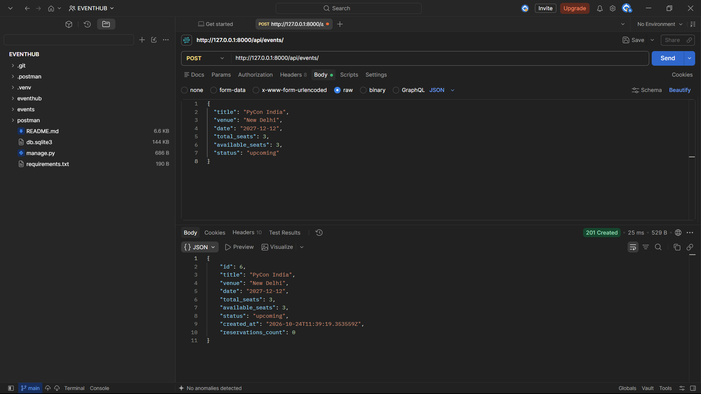
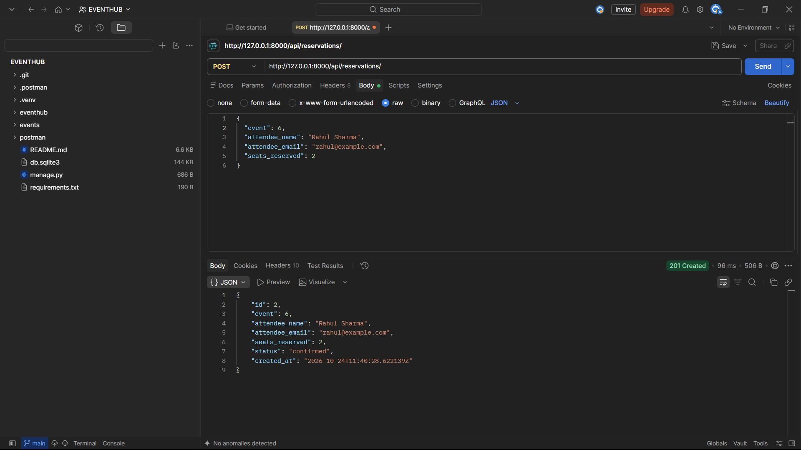
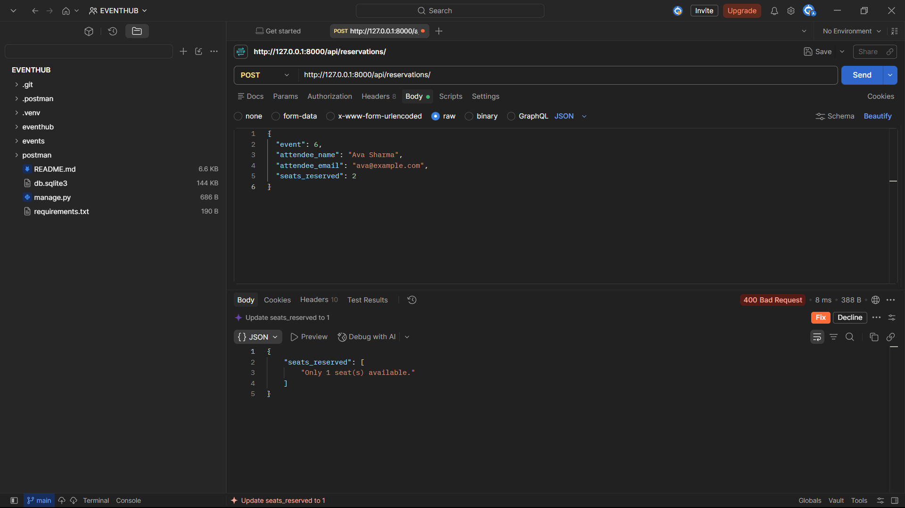
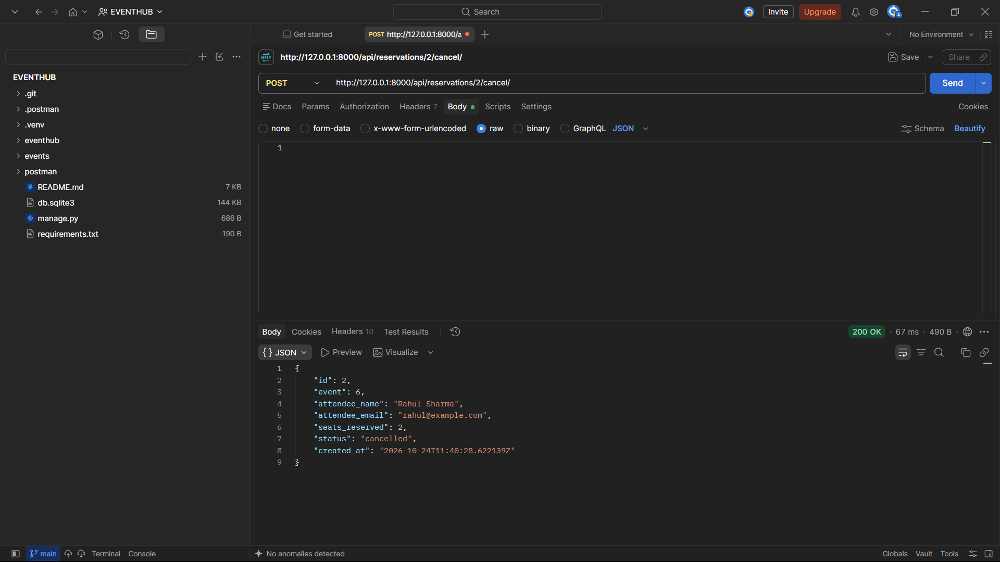

# EventHub API

A RESTful event management API built using Django and Django REST Framework. EventHub allows users to browse events, reserve seats, check availability, and cancel reservations.

## Features

- Create, list, retrieve, update, and delete events
- Filter events by status and venue
- Create and list reservations
- Filter reservations by event ID
- Automatically deduct seats when a reservation is created
- Restore seats when a reservation is cancelled
- Prevent overbooking and invalid seat quantities
- Reject reservations for completed or cancelled events
- Prevent duplicate cancellation and reservation edits
- Count confirmed reservations for each event
- Enforce database-level constraints for seat counts
- Log HTTP requests, response statuses, and request durations
- Automated tests for API functionality and validation
- Django Admin registration for events and reservations

## Tech Stack

- Python 3.13
- Django 6.1.2
- Django REST Framework 3.18.3
- SQLite
- Django automated testing framework

## Installation and Setup

### 1. Clone the repository

```powershell
git clone https://github.com/Avni23314/eventhub-api.git
cd eventhub-api
```

### 2. Create and activate a virtual environment

For Windows PowerShell:

```powershell
python -m venv .venv
.\.venv\Scripts\Activate.ps1
```

### 3. Install dependencies

```powershell
python -m pip install -r requirements.txt
```

### 4. Configure the Django secret key

The application reads its secret key from the `DJANGO_SECRET_KEY` environment variable.

For local development, set it in PowerShell before running Django commands:

```powershell
$env:DJANGO_SECRET_KEY = "your-local-development-secret"
```

Replace the example value with a private local development key. Do not commit real secrets to GitHub.

### 5. Apply database migrations

```powershell
python manage.py migrate
```

### 6. Start the development server

```powershell
python manage.py runserver
```

The API base URL is:

`http://127.0.0.1:8000/api/`

The browsable API is available through a web browser. The root URL `/` does not have a configured homepage.

## API Endpoints

### Events

| Method | Endpoint | Description |
|---|---|---|
| GET | `/api/events/` | List events |
| POST | `/api/events/` | Create an event |
| GET | `/api/events/{id}/` | Retrieve an event |
| PUT | `/api/events/{id}/` | Replace an event |
| PATCH | `/api/events/{id}/` | Partially update an event |
| DELETE | `/api/events/{id}/` | Delete an event |

Each event includes a `reservations_count` field representing the number of confirmed reservations.

### Reservations

| Method | Endpoint | Description |
|---|---|---|
| GET | `/api/reservations/` | List reservations |
| POST | `/api/reservations/` | Create a reservation |
| GET | `/api/reservations/{id}/` | Retrieve a reservation |
| POST | `/api/reservations/{id}/cancel/` | Cancel a reservation and restore its seats |

Existing reservations cannot be edited. To change a booking, cancel it and create a new reservation.

Replace `{id}` with the relevant event or reservation ID.

## Filtering

Filter events by status:

```http
GET /api/events/?status=upcoming
```

Filter events by venue. Venue filtering is case-insensitive and supports partial matches:

```http
GET /api/events/?venue=Delhi
```

Filter reservations by event ID:

```http
GET /api/reservations/?event_id=1
```

Use IDs and filter values that match records in your database.

## Sample API Requests

### Create an event

Send a `POST` request to `/api/events/` with a JSON body:

```json
{
  "title": "PyCon India",
  "venue": "New Delhi",
  "date": "2027-12-12",
  "total_seats": 100,
  "available_seats": 100,
  "status": "upcoming"
}
```

Use a valid date and event details appropriate to your test.

### Create a reservation

Send a `POST` request to `/api/reservations/`:

```json
{
  "event": 6,
  "attendee_name": "Rahul Sharma",
  "attendee_email": "rahul@example.com",
  "seats_reserved": 2
}
```

Replace `event: 6` with the ID of an existing event that has sufficient available seats.

A successful reservation returns **`201 Created`**. The event's available seat count decreases automatically.

### Overbooking response

To test overbooking, first create an event with a limited number of available seats. Make a successful reservation that leaves fewer seats available than the next reservation requests.

For example, if an event has only 1 seat remaining, submit the following request to `POST /api/reservations/`:

```json
{
  "event": 6,
  "attendee_name": "Ava Sharma",
  "attendee_email": "ava@example.com",
  "seats_reserved": 2
}
```

Replace `6` with the ID of your existing event.

The API should return **`400 Bad Request`** because the requested number of seats exceeds availability. The expected JSON response is:

```json
{
  "seats_reserved": [
    "Only 1 seat(s) available."
  ]
}
```

The reservation is rejected, and the event's available seat count remains unchanged.

### Cancel a reservation

Send a `POST` request to `/api/reservations/<reservation_id>/cancel/`. No request body is needed.
The `<reservation_id>` should be replaced with the actual reservation ID.

A successful cancellation returns the updated reservation with status `cancelled` and restores the reserved seats to the event. Trying to cancel it again returns `400 Bad Request`.

## Request Logging Middleware

The custom `RequestLoggingMiddleware` records the HTTP method, request path, response status code, and request duration. Logs appear in the development server terminal, making API activity easier to monitor and debug.

## Design Decision

Reservation creation and seat deduction are handled together in the reservation serializer's `create()` method. This keeps the booking operation in one place and ensures that a reservation is not created if the availability check fails.

The implementation uses a database transaction and rechecks availability when creating the reservation. The code also uses `select_for_update()` to request row locking on databases that support it. The project uses SQLite for development, so this should not be treated as full protection against concurrent booking races in a production environment.

## Running Tests

Run the automated tests:

```powershell
python manage.py test events
```

Run Django's system check:

```powershell
python manage.py check
```

The current test suite contains 17 tests covering event and reservation functionality, filtering, validation, seat availability, cancellation, and database constraints.

## Database Migrations

After modifying models, create and apply migrations:

```powershell
python manage.py makemigrations
python manage.py migrate
```

Committed migrations are located in `events/migrations/`.

## Submission Evidence

The following Postman screenshots demonstrate the API's main workflows and validation behavior.

### 1. Event Creation



### 2. Successful Reservation — 201 Created



### 3. Overbooking Rejected — 400 Bad Request



### 4. Successful Reservation Cancellation



## License

No license has been specified. Add a license if you intend to distribute this project under specific reuse terms.